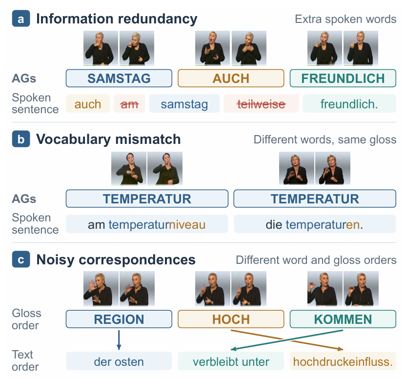
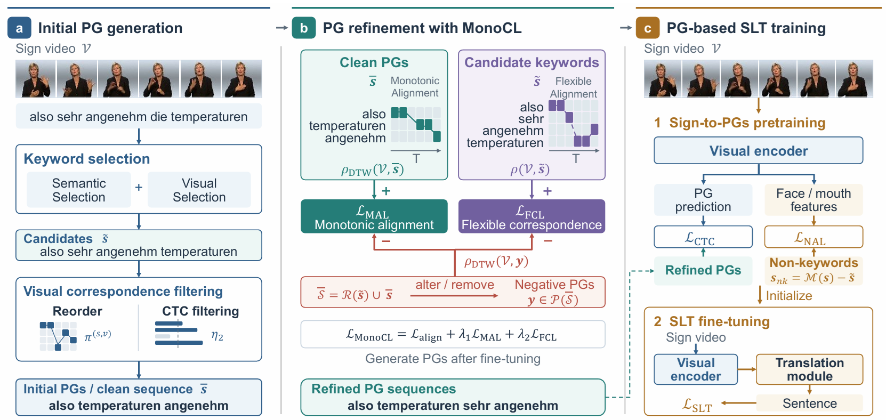

# Monotonic Contrastive Learning for Gloss-free Sign Language Translation

## Release of How2Sign Pseudo Glosses

This repository releases the pseudo-gloss annotations generated for the How2Sign dataset in our paper **Monotonic Contrastive Learning for Gloss-free Sign Language Translation**. The annotations are automatically generated from spoken sentences and can be used as reusable intermediate supervision for gloss-free sign language translation.

The release does **not** contain raw How2Sign videos. Please download the videos and official realigned annotations from the How2Sign dataset, and use `SENTENCE_NAME` to index the pseudo glosses.

## Overview



Pseudo glosses are useful for bridging gloss-free and gloss-based SLT, but directly deriving them from spoken sentences introduces several issues, as shown above. Spoken sentences often contain redundant function words or descriptive words that are not explicitly signed; their lexical forms may differ from annotated glosses;  and automatically generated PGs may have noisy correspondences with visual segments. These problems weaken their ability to provide reliable temporal supervision.



Our method addresses these issues with a three-stage pipeline. First, candidate pseudo glosses are selected from the spoken sentences by combining semantic importance and visual correspondence, then a CTC-based filter removes visually unsupported words to obtain an initial clean pseudo-gloss sequence. Second, Monotonic Contrastive Learning (MonoCL) refines the sequence by strengthening reliable monotonic video-word alignments while recovering plausible words that may have been filtered out. Finally, the refined pseudo glosses are used as intermediate labels for SLT training, similar to annotated glosses in gloss-based methods, with an additional non-manual auxiliary loss to preserve information not fully represented by gloss-like words.

## Files

### How2Sign

| File | Description | #Items |
| --- | --- | ---: |
| `train_pseudo_glosses.json` | Pseudo glosses for the How2Sign training split | 30,384 |
| `val_pseudo_glosses.json` | Pseudo glosses for the validation split | 1,713 |
| `test_pseudo_glosses.json` | Pseudo glosses for the test split | 2,328 |
| `word_dict.json` | Pseudo-gloss vocabulary, usable like `gloss_dict` in gloss-based SLT methods | 7,696 |

### PHOENIX14T

| File | Description | #Items |
| --- | --- | ---: |
| `train_pseudo_glosses.json` | Pseudo glosses for the PHOENIX14T training split | 7,096 |
| `dev_pseudo_glosses.json` | Pseudo glosses for the validation split | 519 |
| `test_pseudo_glosses.json` | Pseudo glosses for the test split | 642 |
| `word_dict.json` | Pseudo-gloss vocabulary, usable like `gloss_dict` in gloss-based SLT methods | 1,451 |

### CSL-Daily

| File | Description | #Items |
| --- | --- | ---: |
| `train_pseudo_glosses.json` | Pseudo glosses for the CSL-Daily training split | 18,400 |
| `dev_pseudo_glosses.json` | Pseudo glosses for the validation split | 1,077 |
| `test_pseudo_glosses.json` | Pseudo glosses for the test split | 1,176 |
| `word_dict.json` | Pseudo-gloss vocabulary, usable like `gloss_dict` in gloss-based SLT methods | 6,102 |

## Format

Each pseudo-gloss file is a JSON dictionary:

```json
{
  "SENTENCE_NAME": "pseudo gloss sequence"
}
```

Example:

```json
{
  "--7E2sU6zP4_10-5-rgb_front": "i call they decorate element because base all mean do to enrich and color page"
}
```

`word_dict.json` maps each pseudo-gloss token to an integer id:

```json
{
  "a": 1,
  "aa": 2
}
```

## Usage

These pseudo glosses can be used as intermediate labels in gloss-based SLT pipelines, e.g., for CTC-style sign-to-gloss supervision before translation training. Empty strings indicate that no reliable pseudo gloss was retained for that sample.

On How2Sign, MonoCL achieves competitive translation performance without manual gloss annotations, reaching **15.82 BLEU-4** on the test set with only skeleton inputs.
